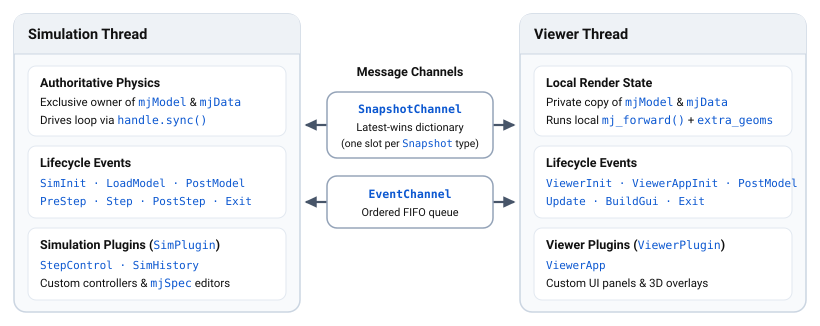
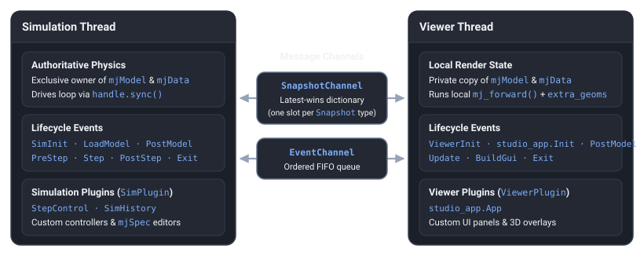

.. _StudioArchitecture:

============
Architecture
============

MuJoCo Studio's architecture rests on three core ideas:

1. **Decoupled simulation and visualization**: Physics simulation and UI/rendering run on separate threads with no
   shared mutable state, communicating strictly through typed :ref:`Snapshot and Event message channels
   <StudioMessaging>`. Any :ref:`Python plugin <StudioPythonPlugins>` therefore works unchanged against both a local
   :ref:`NativeViewer <StudioNativeViewers>` window and a remote :ref:`WebViewer <StudioWebViewers>` browser session.
2. **Composable extensibility via plugins**: Built-in features—including the standard Studio UI (``viewer_app.ViewerApp``),
   real-time physics stepping (``step_control.StepControl``), and trajectory history scrubbing
   (``sim_history.SimHistory``)—are implemented as modular :ref:`viewer and simulation plugins <StudioPythonPlugins>`
   that applications can mix, replace, or extend with custom UI panels, 3D overlays, and stepping backends.
3. **Shared C++ components**: Core UI panels, 3D viewport interaction, physics step pacing, trajectory history buffers,
   and :ref:`Filament <FilamentRendering>` rendering are implemented as modular C++ libraries that compile both to
   native machine code (with Python bindings) and to WebAssembly (with JavaScript bindings), ensuring consistent
   behavior across C++, Python, and browser targets.

.. _StudioThreads:

Thread Model
============

In Python, Studio separates physics simulation from rendering and UI presentation across two execution contexts
connected by :ref:`message channels <StudioMessaging>` (``SimEndpoint`` ↔ ``ViewerEndpoint``), allowing the viewer and
simulation to run on separate threads or in independent processes:

This decoupled design provides three architectural guarantees:

- **Zero shared-state contention**: Unlike the legacy :ref:`passive viewer <PyViewerPassive>`, which required user
  scripts to acquire ``with viewer.lock():`` before mutating :ref:`mjModel` or :ref:`mjData`, Studio's simulation thread
  exclusively owns the authoritative physics structs. After each step, ``ViewerHandle.sync()`` extracts the flat
  integration state vector via :ref:`mj_getState` (``mjSTATE_INTEGRATION``) into an immutable
  ``StateSnapshot(state, state_sig)``. The viewer thread applies the latest snapshot to its private copy of
  :ref:`mjData` via :ref:`mj_setState` and runs :ref:`mj_forward` locally at display refresh rate without blocking
  physics.
- **Background viewer daemon thread**: Both :ref:`native <StudioNativeViewers>` and :ref:`web <StudioWebViewers>`
  Python launchers spawn the viewer loop on a background daemon thread (`launch_thread.py
  <https://github.com/google-deepmind/mujoco/blob/main/python/mujoco/studio/launch_thread.py>`__) while running the
  simulation sync loop or caller ``with`` block on the calling thread. Unhandled exceptions on the viewer thread are
  logged immediately and re-raised on the simulation thread when ``ViewerHandle.close()`` runs.
- **Unified plugin contract**: Because :ref:`viewer plugins <StudioViewerPlugins>` and :ref:`simulation plugins
  <StudioSimPlugins>` communicate exclusively through typed ``Snapshot`` and ``Event`` messages rather than shared
  memory, plugin classes work unchanged across native desktop windows and remote :ref:`WebViewer <StudioWebViewer>`
  browser sessions.

Python vs. C++
==============

Studio adapts its execution model to each runtime environment:

- **Python** (``mujoco.studio``): Simulation and viewer endpoints hold separate :ref:`mjModel` and :ref:`mjData`
  instances and communicate strictly through directional ``Snapshot`` and ``Event`` channels.
- **C++ Desktop** (:ref:`mujoco::studio::App <StudioCpp>`): Runs physics on a dedicated background thread synchronized
  with the main UI and rendering loop.
- **C++ WebAssembly** (:ref:`MuJoCo Live <StudioLive>`): Drives physics updates, Dear ImGui layout, and Filament WebGL
  rendering sequentially inside the browser's single-threaded ``requestAnimationFrame`` loop.

.. _StudioCppComponents:

C++ Components
--------------

Beneath both the Python SDK and the C++ applications sits a shared layer of reusable C++ components under `studio/
<https://github.com/google-deepmind/mujoco/tree/main/studio>`__:

- **UI & interaction** (`ux/ <https://github.com/google-deepmind/mujoco/tree/main/studio/ux>`__): Built-in Dear ImGui
  panels—model hierarchy, physics and rendering options, actuator controls, joint sliders, sensor and solver plots, the
  ``SimHistory`` timeline scrubber, ``Console``, picture-in-picture views, and custom widgets in ``imgui_widgets.h``—along
  with 3D mouse picking, camera motion, and body perturbation in ``interaction.h``. Exposed to Python via
  ``mujoco.studio.ux``, which releases the Python GIL during C++ execution.
- **Simulation state management** (`sim/ <https://github.com/google-deepmind/mujoco/tree/main/studio/sim>`__): Real-time
  step pacing and control noise via ``StepControl``, ring-buffer trajectory recording and scrubbing via ``SimHistory``,
  profiling via ``SimProfiler``, and model lifecycle management via ``ModelHolder``, wrapped by Python's
  ``step_control`` and ``sim_history`` modules.
- **Rendering & windowing** (`hal/ <https://github.com/google-deepmind/mujoco/tree/main/studio/hal>`__, `render/
  <https://github.com/google-deepmind/mujoco/tree/main/studio/render>`__): Hardware-abstracted :ref:`Filament
  <FilamentRendering>` rendering via ``FilamentRenderer`` and ``ModelScene``, plus SDL2 and offscreen window management
  across OpenGL, Vulkan, and WebGL.

Because these C++ libraries compile to native binaries, bind to Python via ``pybind11``, and compile to WebAssembly via
Emscripten with JavaScript bindings, any component or custom widget that needs to be shared across C++, Python, and
JavaScript/WebAssembly surfaces should be implemented in C++ and bound to Python and JS. Pure Python plugins execute on
the host CPU—streaming their UI draw lists to the browser in :ref:`WebViewer <StudioWebViewer>`—whereas C++
components can run natively on the host *and* client-side inside WebAssembly browser apps such as :ref:`MuJoCo Live
<StudioLive>` and the ``WebViewer`` browser client.

.. _StudioMessaging:
.. _StudioSnapshotsVsEvents:

Message Passing
===============

Because the simulation and viewer loops run on separate threads with no shared mutable state (see :ref:`Thread Model
<StudioThreads>`), all state updates and commands cross the endpoint boundary as typed messages defined in `messages.py
<https://github.com/google-deepmind/mujoco/blob/main/python/mujoco/studio/messages.py>`__.

Snapshots vs. Events
--------------------

Communication is divided into two ``Message`` base classes with distinct delivery semantics. By convention, custom
message subclasses end in ``*Snapshot`` or ``*Event``:

.. list-table::
   :widths: 18 24 23 35
   :header-rows: 1

   * - Base Class
     - Channel Type
     - Delivery Guarantee
     - Examples
   * - ``messages.Snapshot``
     - ``SnapshotChannel`` is a latest-wins dictionary with one slot per ``Snapshot`` subclass, keyed by ``type(msg)``.
     - Only the most recent snapshot of each type is delivered on drain.
     - ``StateSnapshot``, ``StepControlSnapshot``, ``SimHistorySnapshot``, ``MjOptionSnapshot``, ``PerturbSnapshot``
   * - ``messages.Event``
     - ``EventChannel`` is a strictly ordered FIFO queue.
     - Every queued event is delivered in order; no event is dropped.
     - ``ModelEvent``, ``LoadModelEvent``, ``StateEvent``, ``KeyframeEvent``, ``ResetEvent``, ``SingleStepEvent``,
       ``RequestPauseEvent``, ``ThreadPoolEvent``, ``HotReloadEvent``

Choosing a Type
---------------

When designing custom messages for GUI widgets or plugin communication:

- **Use a** ``Snapshot`` **for continuous GUI options such as sliders, toggles, and settings** where a message carries
  the complete current value and only the latest value matters, such as ``StepControlSnapshot``, ``MjOptionSnapshot``,
  or a plugin's own ``FooConfigSnapshot``. If the viewer renders faster than the simulation steps while a user drags a
  slider, intermediate values coalesce automatically instead of queuing up.
- **Use an** ``Event`` **for discrete GUI button actions and one-shot commands** such as ``ResetEvent``,
  ``SingleStepEvent``, ``RequestPauseEvent``, ``LoadModelEvent``, and ``KeyframeEvent``, and when distinct partial
  updates of the same class would clobber one another in ``SnapshotChannel``'s per-type slot—for example,
  ``StateEvent(state, state_sig)`` applies targeted state overrides whose ``state_sig`` bitmasks differ so each
  component is applied in order.

For chronological :ref:`lifecycle event tables <StudioLifecycle>`, :ref:`diff-based synchronization <StudioDiffSync>`,
and :ref:`handler priorities <StudioPriorities>`, see :ref:`Python Plugins <StudioPythonPlugins>`.
