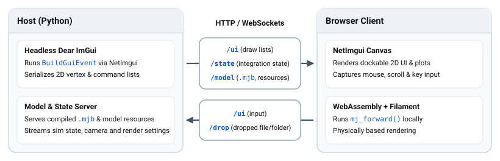
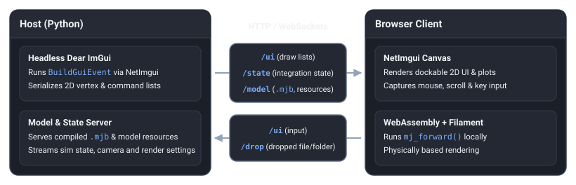

.. _StudioWebViewers:
.. _StudioBrowser:

===========
Web Viewers
===========

Studio provides two ways to run in a web browser depending on where physics and user code execute:

- **MuJoCo Live** (`live.mujoco.org <https://live.mujoco.org>`__): Compiles C++ Studio directly to WebAssembly so the
  entire simulator and renderer run client-side on a static page with zero install.
- **Python** ``WebViewer``: Runs your Python simulation and custom plugins headlessly on a workstation or remote server
  (no GPU or window system required on the host) and streams UI draw lists and simulation state to the browser.

.. _StudioLive:

MuJoCo Live
===========

**MuJoCo Live** (`live.mujoco.org <https://live.mujoco.org>`__) is the standalone browser build of the C++ Studio
application, running physics simulation, Dear ImGui UI, and :ref:`Filament <FilamentRendering>` rendering inside the
browser tab with no backend server:

- **Drag-and-drop models**: Drop a standalone ``.xml``, ``.mjb``, or self-contained ``.mjz`` / ``.zip`` archive
  directly onto the canvas.
- **Shareable model URLs (** ``?model=`` **)**: Pass ``?model=<url>`` using ``https://``, ``http://``, or the
  ``github:`` shorthand:

  .. cssclass:: code-size

  `https://live.mujoco.org/?model=github:google-deepmind/mujoco/main/model/humanoid/humanoid.xml
  <https://live.mujoco.org/?model=github:google-deepmind/mujoco/main/model/humanoid/humanoid.xml>`__

  When loading an XML model by URL, MuJoCo Live discovers transitive meshes, textures, and ``<include>`` files via
  ``mju_getXMLDependencies`` and prefetches them in parallel before compiling. Every robot thumbnail on the `MuJoCo
  Menagerie <https://github.com/google-deepmind/mujoco_menagerie>`__ page links directly to ``live.mujoco.org`` using
  this ``github:`` syntax, and visiting ``?model=`` with an empty value opens a blank scene without loading the default
  welcome model.

For details on the Emscripten WebAssembly build and C++ bindings, see :ref:`WebAssembly Build <StudioLiveCpp>` in
:ref:`C++ <StudioCpp>`.

.. _StudioWebViewer:

WebViewer
=========

Unlike remote desktop tools such as Chrome Remote Desktop, X11 forwarding, or server-side video encoders that require a
GPU on the host machine and stream compressed video frames, ``WebViewer`` (`web_viewer.py
<https://github.com/google-deepmind/mujoco/blob/main/python/mujoco/studio/web_viewer.py>`__) runs headless on the host
CPU with no native graphics or windowing dependencies and offloads 3D rasterization to the client browser over a single
HTTP/WebSocket port. A host GPU is only needed if user code itself renders offscreen camera observations.

Launching
---------

Start ``WebViewer`` from the command line or from Python via `launch_web
<https://github.com/google-deepmind/mujoco/blob/main/python/mujoco/studio/launch_web.py>`__. Everything is served over a
single ``http_port``, which defaults to ``0`` and selects the first free port ``>= 8080``. Set ``open_browser=True`` on
``ViewerConfig`` to open a browser tab automatically, and forward the port via ``ssh -L 8080:localhost:8080`` when
running on a remote machine:

.. code-block:: shell

   python -m mujoco.studio.viewer --model=humanoid.xml --gfx=web

.. code-block:: python

   from mujoco.studio import launch_web
   from mujoco.studio import viewer_app
   from mujoco.studio import viewer_protocol

   config = viewer_protocol.ViewerConfig(title='MuJoCo Studio')

   launch_web.run(
       config,
       model_path='humanoid.xml',
       plugins=[viewer_app.ViewerApp(), *viewer_app.SIM_PLUGINS],
   )

Like :ref:`launch_native <StudioExecutionModes>`, non-blocking mode is supported via ``launch_web.launch`` when
attaching ``WebViewer`` to an existing simulation loop; see `custom_sim_loop.py
<https://github.com/google-deepmind/mujoco/blob/main/python/mujoco/sample/studio/custom_sim_loop.py>`__.

Streaming Architecture
----------------------

Python :ref:`Message <StudioMessaging>` types (``Snapshot`` and ``Event``) only travel between the Python simulation and
viewer endpoints—the host-to-browser wire protocol is fixed and independent of custom plugin message classes:

- **UI Stream (** ``/ui`` **)**: The host executes all ``BuildGuiEvent`` handlers from ``ViewerApp`` and custom Python
  ``ViewerPlugin`` windows in a headless Dear ImGui context and streams compact 2D vertex/index draw lists via
  `NetImgui <https://github.com/sammyfreg/netImgui>`__. Because most UI panels and widgets remain static from frame to
  frame, NetImgui applies per-window delta compression—comparing each window's vertex, index, and draw-command buffers
  against the previous frame and transmitting only the elements that changed—keeping CPU overhead and bandwidth minimal
  at a few kilobytes per second while rendering crisp vector UI at native browser resolution. Mouse clicks, drags,
  scroll wheel events, and keystrokes captured in the browser flow back over ``/ui`` to the host.
- **Scene & Model Streams (** ``/model`` **,** ``/state`` **,** ``/drop`` **)**: When a model loads, the host serves the
  compiled :ref:`mjModel` (``.mjb``) and bundled resources over ``/model``, and streams per-frame integration state,
  camera transforms, :ref:`mjvOption` flags, :ref:`mjvPerturb` state, and ``extra_geoms`` over ``/state`` with
  latest-wins semantics so the browser's WebAssembly client can run :ref:`mj_forward` and render via Filament WebGL 2.0.
  Model files or folders dropped onto the browser canvas upload over ``/drop`` to the host and trigger
  ``LoadModelEvent`` on the simulation thread.

Multi-Viewer Sessions
---------------------

Multiple browsers can connect to the same ``WebViewer`` URL simultaneously, coordinated by a **Role** indicator UI:

- **Controller vs. Spectators**: Only **one** browser at a time holds the **Controller** role (``CONTROLLING``), which
  owns the ``/ui`` NetImgui stream, sees and interacts with the Dear ImGui panels, perturbs bodies, and can
  drag-and-drop models onto the page. Additional browsers join as **Spectators** (``SPECTATING``): they receive only the
  ``/model`` bundle and ``/state`` simulation stream with no ``/ui`` traffic, and can switch their local camera in the
  Role UI between ``Free: tumble``, ``Free: wasd``, and ``Follow Controller``.
- **Control queue & Steal Control**: A spectator can click **Request control** in the Role UI to join the FIFO control
  queue, pulsing the controller's Role indicator orange with the waiting count, or click **Leave Queue** to cancel.
  When the controller clicks **Release control** or closes their tab, the server grants control to the head of the
  queue. Queued spectators can also click **Steal Control** to jump the queue and take control immediately, demoting the
  current controller to a spectator.
- **Max spectators & outgoing bandwidth**: Because the server streams the 60 Hz ``/state`` payload to every connected
  browser, total outgoing simulation bandwidth scales with the viewer count and is reported in the Role UI as ``Sim Data
  Rate``. The controller can adjust **Max Spectators** at runtime from ``0`` to ``32`` (default ``8``) to cap outgoing
  simulation state traffic; excess spectators are disconnected newest-first with a *Session is full* notice and retry
  automatically until a slot frees up.
- **Idle disconnects & reconnection**: Hidden or backgrounded browser tabs pause their rendering loop and stop sending
  traffic. If a controller tab sends no input for **90 seconds** while someone is waiting in the control queue, control
  is automatically handed off; if a spectator tab sends no 30-second heartbeat for **5 minutes**, it is disconnected to
  free its slot and reconnects automatically when the tab is focused again. Each client also acknowledges ``/state``
  frames so at most one state payload is in flight over slow links, and displays a *Viewer server is not reachable*
  notice if the Python process stops or stalls.

.. warning::
   ``WebViewer`` serves plain HTTP and WebSockets without authentication or encryption and currently listens on all
   network interfaces—anyone who can reach the port can take or steal control, upload files, and view host logs,
   exception messages, and file paths. While usability and access-control improvements are in progress, ``WebViewer`` is
   a development tool and **will not come with security guarantees** against untrusted networks. Run it on ``localhost``,
   on trusted networks, or through an authenticated tunnel such as ``ssh -L 8080:localhost:8080``.

.. _StudioBrowserSandboxing:

Browser Sandboxing
==================

Unlike native desktop applications, web browsers execute pages inside a security sandbox that restricts multithreading,
network requests, filesystem access, and memory, and keep WebAssembly modules resident for the life of the page rather
than running a fresh OS process per session. The points below summarize how these browser behaviors affect
``WebViewer`` and ``MuJoCo Live``:

- **COOP/COEP headers and WebAssembly multithreading** (*both* ``WebViewer`` *and* ``MuJoCo Live``): In WebAssembly, C++
  threads (POSIX ``pthreads``) are backed by browser Web Workers that share memory through ``SharedArrayBuffer``. To
  mitigate side-channel timing attacks, browsers block ``SharedArrayBuffer`` unless the page is *cross-origin
  isolated*—meaning the HTTP server sends ``Cross-Origin-Opener-Policy: same-origin`` (COOP) and
  ``Cross-Origin-Embedder-Policy: require-corp`` (COEP).

  - In **WebViewer**, the browser's WebAssembly rendering client (``web_client``) is compiled with ``pthreads``, so
    ``WebViewer``'s built-in Python server automatically attaches ``COOP`` and ``COEP`` headers to every HTTP response
    and WebSocket upgrade handshake.
  - In **MuJoCo Live**, if a static web host does not serve ``COOP`` and ``COEP`` headers—or on mobile browsers such as
    iOS WebKit where ``MuJoCo Live`` loads a dedicated single-threaded build—``SharedArrayBuffer`` is unavailable, the
    simulation runs single-threaded on the browser's main thread, and the *Threads* slider is disabled.
- **Secure context requirement (** ``localhost`` **or HTTPS)** (``WebViewer`` *and self-hosted* ``MuJoCo Live``):
  Browsers only enable ``SharedArrayBuffer`` in *secure contexts*, meaning ``http://localhost``, ``127.0.0.1``, or
  ``https://``. Opening a remote ``WebViewer`` over plain ``http://<remote-ip>:<port>`` disables ``SharedArrayBuffer``
  and prevents the WebAssembly client from initializing. When running ``WebViewer`` on a remote workstation or headless
  server, forward the port to your local machine via ``ssh -L 8080:localhost:8080`` and open ``http://localhost:8080``,
  or place the server behind an ``https://`` reverse proxy that forwards the ``COOP`` and ``COEP`` headers on both HTTP
  and WebSocket responses.
- **Cross-origin model URLs (CORS & CORP)** (``MuJoCo Live``): When ``MuJoCo Live`` loads an external model via
  ``?model=<url>``, the browser fetches the XML and any referenced meshes or textures directly from the remote server.
  The remote server must permit cross-origin requests via ``Access-Control-Allow-Origin``—as ``github:`` URLs on
  ``raw.githubusercontent.com`` do—and if ``COEP: require-corp`` is enabled on the hosting page, cross-origin assets
  must also include a permissive ``Cross-Origin-Resource-Policy`` header.
- **Where physics runs & backgrounded tabs** (``WebViewer`` *vs.* ``MuJoCo Live``): In **WebViewer**, Python code,
  physics stepping, and C++ thread pools run natively on the host machine; minimizing or switching away from the browser
  tab only pauses 3D rendering in that tab while the host simulation continues running. In **MuJoCo Live**, physics and
  rendering both step inside the browser's ``requestAnimationFrame`` loop rather than on a separate background thread,
  so backgrounding the tab pauses the simulation.
- **Filesystem access & memory limits** (``WebViewer`` *vs.* ``MuJoCo Live``): A browser tab cannot read file paths on
  your local disk directly. In **WebViewer**, host Python code has normal access to the host filesystem, and files or
  folders dropped onto the browser canvas are uploaded over ``/drop`` to a temporary directory on the host. In **MuJoCo
  Live**, dropped files and ``.zip`` / ``.mjz`` archives are unpacked into an in-memory virtual filesystem that exists
  only for the lifetime of the tab. Similarly, 32-bit WebAssembly caps linear memory at 4 GiB on desktop browsers and
  512 MiB on iOS; in **WebViewer** this limit applies only to the browser's rendering scene while the simulation uses
  host RAM, whereas in **MuJoCo Live** the entire simulation and history buffer reside inside the browser's WebAssembly
  heap.
- **WebAssembly module lifetime & persistent C++ state** (``MuJoCo Live`` *and sequential Python sessions*): Unlike a
  standalone desktop executable whose entire address space is reclaimed by the OS when the process exits, a compiled
  WebAssembly module and its linear memory remain resident for as long as the page keeps the module loaded. When an
  embedding page stops and restarts the viewer across JavaScript ``deinit`` and ``init`` calls, all C++ global and
  ``static`` variables persist across runs:

  - **Global UI contexts and singletons**: Libraries such as Dear ImGui and ImPlot track their active state through
    global context pointers, and creating a new context does not free an existing one—if teardown skips
    ``DestroyContext``, the next ``CreateContext`` allocates and leaks a new context while leaving the global pointer
    bound to the stale previous one (or leaks the old context's buffers if the global pointer is reassigned). Studio
    destroys its UI contexts during window and app teardown so each ``init`` starts cleanly and returns freed blocks
    to the allocator inside the WebAssembly heap; custom C++ plugins and bindings must reset any global or ``static``
    state the same way. Note that while C++ destructors make freed memory reusable within the module, a
    ``WebAssembly.Memory`` buffer can grow up to the browser ceiling but never shrinks back to the OS until the tab
    reloads or drops all references to the module.
  - **Same behavior in Python**: Compiled C++ extension modules remain loaded in the Python interpreter process rather
    than unloading when a viewer window or ``with`` block closes, so C++ global and ``static`` state persists—and
    leaks if not torn down—across sequential viewer windows, notebook cells, and tests in a single process in the
    exact same way.
