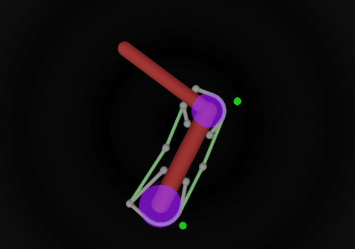

# Two-link arm with six muscles

A planar arm with a shoulder and an elbow hinge, actuated by six
[muscles](https://mujoco.readthedocs.io/en/latest/modeling.html#cmuscle) acting through
[spatial tendons](https://mujoco.readthedocs.io/en/latest/XMLreference.html#tendon-spatial) that wrap
around cylinders at the joints. This is the classic two-link, six-muscle arm used in motor control
research ([Katayama & Kawato 1993](https://doi.org/10.1007/BF01185407);
[Li & Todorov 2004](https://doi.org/10.5220/0001143902220229)). It should
not be confused with the anatomical OpenSim model of the same name.

  

Click the image to open the model in the browser viewer at [live.mujoco.org](https://live.mujoco.org).

| Muscle | Spans | Action |
| --- | --- | --- |
| `SF` | shoulder | flexor |
| `SE` | shoulder | extensor |
| `EF` | elbow | flexor |
| `EE` | elbow | extensor |
| `BF` | shoulder and elbow | biarticular flexor |
| `BE` | shoulder and elbow | biarticular extensor |

The flexors wrap the joint cylinders on the inside of the bend without help. The extensors wrap the
outside, which a shortest path would abandon as the joint flexes, so each of their geom wraps has a
[side site](https://mujoco.readthedocs.io/en/latest/XMLreference.html#spatial-geom-sidesite)
(`x0` at the shoulder, `x1` at the elbow, shown in green with the cylinders in group 1). A tendon
goes around the cylinder the same way as the path through its side site, and snaps off when an
attachment site crosses the ray opposite the side site. The side sites are therefore placed 45°
below the arm, so that this ray stays clear of the insertion sites over the 0–120° joint range.

## Changelog

* 28-10-2026: Moved the side sites `x0` and `x1` from 90° to 45° below the arm, for the new side site
  semantics. Tendon lengths are unchanged over the full range of motion.
* 2021: Initial release.
